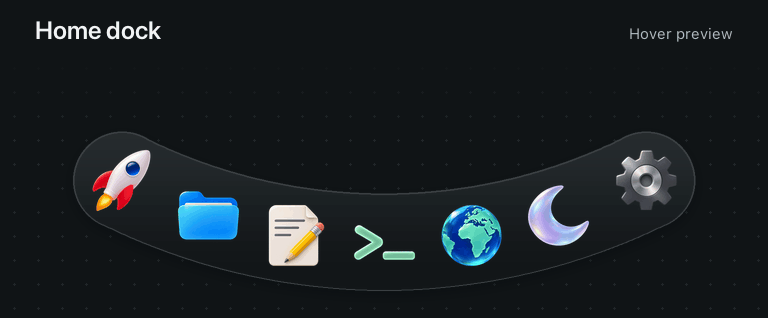
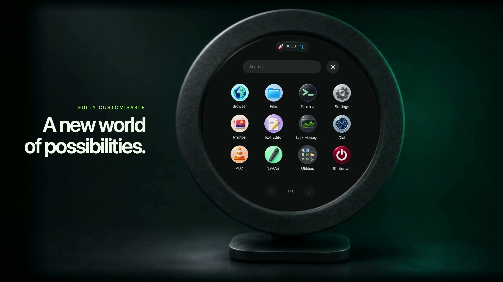
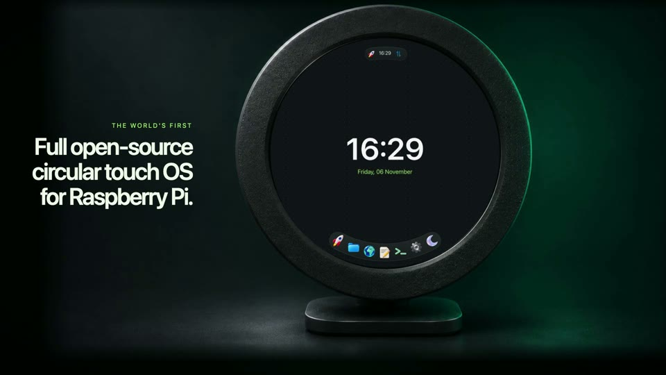

# AroundOS

[Read the setup guide](Enclosure%203D%20Print%20Files/Assembly%20Manual/AroundOS%20Assembly%20Manual.pdf)

**A circular desktop experience for Raspberry Pi.**

AroundOS turns a Raspberry Pi and a round touchscreen into a small desktop designed around the shape of its display. Curved system bars, a touch-friendly application launcher, an animated dock and native applications keep essential controls inside the visible circle.

It runs on **Raspberry Pi OS**, using the existing labwc Wayland desktop, GTK and Linux services. It is a desktop customization and application suite, not a standalone Linux distribution or a flashable OS image.

> **Project status:** experimental, hardware-specific software under active development. A clean installation and restore on a second Pi still need verification.



## Contents

- [Features](#features)
- [Hardware](#hardware)
- [How it works](#how-it-works)
- [Getting started](#getting-started)
- [Optional applications](#optional-applications)
- [Using AroundOS](#using-aroundos)
- [3D-printed enclosure](#3d-printed-enclosure)
- [Updates and rollback](#updates-and-rollback)
- [Development and verification](#development-and-verification)
- [Troubleshooting](#troubleshooting)
- [Limitations](#limitations)
- [Repository layout](#repository-layout)
- [Licensing and credits](#licensing-and-credits)

## Features

| Component | What it does |
| --- | --- |
| Circular desktop | Curved glass-style bars, home-only dock, wallpaper clock and running-app controls |
| Dock | Magnification, illustrated shortcuts, hover/touch animation and deliberate hold-to-reorder gestures |
| Apps | Searchable, paginated launcher with swipe navigation and a Utilities folder |
| Files | Touch-friendly folder browsing, grid/list views, sorting, hidden files and default-app opening |
| Photos | Native photo browsing with controls positioned for the round screen |
| Text Editor | Local UTF-8 editing, unsaved-change handling and Save/Save As |
| Terminal | Terminal integration within the circular desktop |
| Browser | Single-page WebKitGTK browser with navigation, searches and persistent website storage |
| Videos | Optional GStreamer player with seeking, volume and circle-safe fullscreen |
| Settings | Network, Bluetooth, sound, display/touch and other native settings pages |
| Task Manager | CPU/RAM overview, searchable processes and confirmed process termination |
| Capture | Circular PNG screenshots and silent transparent WebM screen recordings |
| NavCon | Optional Sony Navigation Controller input with configurable profiles |
| Dial | Optional integration with the separate Dial watch-face application |

## Hardware

The desktop targets this hardware:

- **Raspberry Pi 4 Model B**.
- **[Waveshare 5inch 1080×1080 round LCD touchscreen](https://www.waveshare.com/5inch-1080x1080-lcd.htm)**, connected by HDMI for video and USB for capacitive touch. **Purchase:** use this official Waveshare product page for the display used by the reference build and enclosure.
- Storage running **Raspberry Pi OS 64-bit Desktop**, Debian Trixie based.
- A suitable power supply, HDMI cable and USB touch cable.
- A keyboard for setup and text entry; a mouse is useful during development.
- Optionally, a **Sony Navigation Controller** and the printable enclosure included below.

Configure the round panel on `HDMI-A-1` at **1080 × 1080** and **scale 1**.

Other boards, screens, display names, scaling factors and desktop environments have not been validated. The installer checks the output name, resolution and scale before changing the desktop.

## How it works

AroundOS combines Python GTK applications with a native C module that adapts panel and overlay surfaces. GTK/GIO handles native controls and filesystem integration; Cairo draws circular surfaces. labwc remains the compositor, wf-panel-pi remains the panel, and PCManFM remains available for classic file-management operations.

The physical display masks the corners of a square framebuffer. Layouts therefore keep interactive controls inside circular bounds rather than assuming a rectangular desktop. At 1080 × 1080, the display centre is `(540, 540)`; many checks use a 515-pixel safety radius.

The main installer manages per-user configuration and records a baseline backup. Optional networking and controller compatibility changes are separate and can require administrator privileges.

Run the installer as the Linux user who owns the desktop session. If upgrading from an earlier branding, keep your previous checkout and backups. Use that checkout’s restore command before installing this version so the new installer backs up the original desktop configuration. Existing app preferences and backups use the earlier directory names.

## Getting started



### 1. Prepare Raspberry Pi OS

Install Raspberry Pi OS 64-bit **Desktop**, complete its first-run setup, and start a working labwc desktop on the round display. Confirm HDMI output and USB touch work before applying AroundOS. Keep an independent way to access the Pi, such as SSH or a keyboard.

The desktop installer expects Raspberry Pi OS desktop components to exist already; it is not an installer for a minimal/headless OS. Its runtime and build requirements include Python 3, PyGObject/GTK 3, Cairo, GdkPixbuf, Pillow, GCC, labwc, `wlr-randr`, wf-panel-pi, PCManFM, GSettings and fontconfig. Individual applications have additional requirements described below. There is not yet a tested, complete fresh-image dependency bootstrap.

Back up your storage and any customized desktop configuration before trying an experimental desktop installation.

### 2. Clone the repository on the Pi

```sh
git clone https://github.com/SalvSith/AroundOS.git
cd AroundOS
```

GitHub’s **Download ZIP** also includes the enclosure models and illustrated assembly manual.

Keep the checkout in a stable location: generated launchers reference its source files. Moving the checkout after installation requires reinstalling the relevant launchers.

### 3. Install the desktop customization

Run as the **normal desktop user**, inside that user's active desktop session:

```sh
python3 scripts/round-desktop.py install
```

Do not run the main desktop installer with `sudo`. It backs up managed settings, compiles the surface module, writes per-user launchers/configuration and reloads desktop components. Existing applications may need to be reopened to pick up theme and cursor changes.

The backup pointer is:

```text
~/.local/state/aroundos-round/original-backup
```

Installation does not configure HDMI, calibrate touch, set up networking or install optional application dependencies. See the [implementation and restoration guide](docs/round-desktop/README.md) before applying it to a customized desktop.

### 4. Fonts and artwork

AroundOS uses Rubik for desktop and application interface text. Regular and italic variable fonts are bundled under `src/round-desktop/fonts/` with their SIL Open Font License and installed locally, so no online font service is needed. Terminal and code-editor content retain monospace fonts. Re-run the desktop installer and reopen applications to apply font changes. Older screenshots may show SF Pro. The apps use native fallback icons when optional local symbols are unavailable. See [third-party notices](THIRD_PARTY_NOTICES.md).

## Optional applications

Install the base desktop first. Run targeted installers from the checkout on the Pi as its desktop user. Review each linked guide for dependencies, side effects and rollback.

| Integration | Installer / guide |
| --- | --- |
| Browser | Install `gir1.2-webkit2-4.1`, then `python3 scripts/install-round-browser.py`; [Browser guide](docs/round-desktop/browser.md) |
| Text Editor | `python3 scripts/install-round-editor.py`; [Editor guide](docs/round-desktop/README.md#text-editor) |
| Task Manager | `python3 scripts/install-round-tasks.py`; [Task Manager guide](docs/round-desktop/README.md#task-manager) |
| Videos | Install the documented GStreamer packages, then `python3 scripts/install-round-videos.py`; [Videos guide](docs/round-desktop/videos.md) |
| Screenshot / recording | `python3 scripts/install-round-screenshot.py`; requires the documented capture tools and keyboard access; [Capture guide](docs/round-desktop/README.md#circular-screenshots) |
| NavCon | `python3 scripts/navcon-app.py install`; controller access/pairing are separate; [NavCon guide](docs/navcon/README.md) |
| Dial | Requires a separately built local package before `python3 scripts/dial-app.py install`; [Dial guide](docs/dial/README.md) |

Dial's actual watch-face bundle is **not included** in this repository. Its launcher code alone is insufficient to run it. For wireless pairing, NavCon requires compatible BlueZ packages and Sony controller support. Its optional udev rules require administrator permission.

### Networking and remote development

Ethernet or Wi-Fi can provide SSH access. If you use a USB network gadget, see the [USB networking guide](docs/usb-networking.md).

Use your own account and address:

```sh
ssh YOUR_PI_USER@YOUR_PI_HOST
```

## Using AroundOS

https://github.com/user-attachments/assets/352ab0b6-60f3-4a14-8f67-3f1d3267b9ca

[](video/aroundos-preview.mp4)

- Open **Apps** from the launcher, search for an application or swipe between pages.
- The home dock appears on the desktop. Running applications remain accessible from the top bar.
- Hover or slide across dock icons to magnify them. Hold an icon deliberately before rearranging it.
- Use **Files** for browsing and opening files. Advanced filesystem actions remain available through **Open classic Files**.
- In **Text Editor**, use Ctrl+O, Ctrl+S, Ctrl+Shift+S and Ctrl+W for open, save, save as and close.
- In **Browser**, use Ctrl+L for the address field, Ctrl+R/F5 to reload and Ctrl++/−/0 for zoom.
- In **Videos**, Space toggles playback, arrow keys seek, F toggles fullscreen and Escape exits fullscreen or closes the player.
- Press **Print Screen** for a circular PNG screenshot. Hold it for more than four seconds to begin recording after a countdown; press again or use the toolbar indicator to stop.

Screenshots use the XDG Pictures directory under `Screenshots`; recordings are saved under `~/Videos/Recordings`. Recordings have transparent circular corners and no audio. Export can take time on a Pi; the indicator changes to amber while saving.

## 3D-printed enclosure


The included enclosure is **“Case for round Waveshare 5in Display” by [JN-Husch (@JNHusch)](https://www.printables.com/@JNHusch)**.

- [Original model and instructions](https://www.printables.com/model/847901-case-for-round-waveshare-5in-display)
- [Included files and attribution](Enclosure%203D%20Print%20Files/README.md)
- [Illustrated assembly manual (PDF)](Enclosure%203D%20Print%20Files/Assembly%20Manual/AroundOS%20Assembly%20Manual.pdf)
- [Step-by-step assembly guide](Enclosure%203D%20Print%20Files/Assembly%20Manual/Assembly%20Guide.md)
- [STL files for printing](Enclosure%203D%20Print%20Files/STL%20FILES)
- [STEP files for CAD editing](Enclosure%203D%20Print%20Files/STEP%20FILES)

All five parts are included in both formats: front case, holder plate, rear plate, desk-mount connector and desk-mount base. They are ordinary Git files, so they arrive with a clone or repository ZIP; you do not need to visit Printables to retrieve them.

The creator describes a three-part wall-mounted assembly and two additional parts for a desk stand. STL files are supplied in print orientation; STEP files need orientation before slicing. The original instructions specify printing without supports and assembling with slide/click connections, without extra fasteners. Consult the supplied geometry and your printer's capabilities for material and slicing choices; no universal print profile is provided here.

This enclosure is designed around the **Waveshare display**. The assembly manual shows a Raspberry Pi 4 attached to the screen using the supplied spacers and screws. Verify the actual spacer height, cooler, plug bends and rear-cover clearance before closing; the illustrations do not certify a physical fit or compatibility with other screen models.

**Separate license: CC BY-NC-SA 4.0.** Credit the creator, preserve the license, identify modifications and share distributed adaptations under the same license. Commercial use requires separate permission. The enclosure is not covered by the software license. Including it does not imply the creator endorses AroundOS.

## Updates and rollback

Before updating, preserve local changes and keep the original desktop backup:

```sh
git status
git pull --ff-only
```

Read the change notes before rerunning installers. Updating Git files does not automatically rebuild the native module or regenerate installed launchers. Reapplying the base installer uses its saved baseline and can replace later manual configuration; targeted installers are preferable for isolated features.

To restore the desktop baseline, close custom applications and run from the same checkout:

```sh
python3 scripts/round-desktop.py restore
```

Source files and backups remain. Optional app installers and system-level controller/network changes have their own rollback procedures. The main restore command is not a whole-system uninstall or a restoration of every optional change.

## Development and verification

Read [CONTRIBUTING.md](CONTRIBUTING.md) for contribution scope and checks. Most source lives in `src/round-desktop/`, with optional integrations in `src/navcon/` and `src/dial/`.

Hardware-independent controller regressions:

```sh
python3 scripts/check-navcon-core.py
python3 scripts/check-navcon-input.py
```

Live GTK, compositor, playback and recording checks must run on the Pi in its desktop session, with the corresponding dependencies installed. Examples:

```sh
python3 scripts/check-round-files.py
python3 scripts/check-round-shell.py
python3 scripts/check-round-photos.py
python3 scripts/check-round-touch.py
```

These are integration checks, not a headless cross-platform test suite. Some open windows, synthesize input or generate temporary media. Read the relevant script and feature guide first.

## Troubleshooting

| Symptom | What to check |
| --- | --- |
| Installer rejects display | `wlr-randr --json`: output must be HDMI-A-1 at 1080 × 1080, scale 1 |
| No active labwc session | Run as the logged-in desktop user; avoid root or a different SSH user |
| Missing Python GI module | Use the OS Python and install the corresponding Raspberry Pi OS/Debian GI packages |
| Font or icons differ | Private reference assets are not included; review the fallback and licensing notes |
| App missing in Apps | Run its targeted installer, then reopen Apps |
| App stops launching after moving source | Reinstall its launcher from the checkout's new stable location |
| Browser unavailable | Check the WebKitGTK 4.1 dependency and Browser guide |
| Video fails to play | Check installed GStreamer plugins, codec support and the Videos guide |
| Recording does not start | Check capture dependencies, readable keyboard input and the controller's autostart state |
| Recording appears slow to save | Allow export to finish; review state/logs in `~/.local/state/aroundos-round/` |
| Controller does not reconnect | Review NavCon pairing/runtime notes; pairing with another host can replace its saved host |
| Desktop needs to be undone | Use the saved baseline and the restoration procedure above |

For a report, include the Pi model, OS release, display/output configuration, exact command, relevant error and reproduction steps. Remove credentials, pairing keys and personal information from logs.

## Limitations

- Layouts target one 1080-pixel round display, not arbitrary resolutions or multi-monitor configurations.
- Stock application dialogs can remain rectangular and place controls outside the visible circle.
- Boot, login and lock screens are not redesigned.
- The browser has one page, no download manager and denies site permissions such as camera/microphone/location.
- The text editor handles local UTF-8 documents up to 4 MiB; it is not a full IDE.
- Video format support depends on codecs; DRM and hardware acceleration are not guaranteed.
- Recording is silent; long captures and exports consume storage and CPU.
- Touch feel, accessibility, a clean-device installation and portable asset licensing still need broader validation.
- No flashable image, automatic updater or production support guarantee is provided.

## Repository layout

```text
src/round-desktop/          Native apps, GTK theme, panel module and artwork
src/navcon/                 Controller integration
src/dial/                   Dial launcher integration
scripts/                    Installers, build helpers and checks
docs/                       Installation and feature guides
Enclosure 3D Print Files/   STL/STEP models, enclosure image and separate license
video/aroundos-preview.mp4  AroundOS preview
local-assets/               Ignored, locally supplied assets and build inputs
```

## Licensing and credits

Original AroundOS software and original project assets are available under the [AroundOS Noncommercial License](LICENSE). Projects incorporating them must be free of charge and may not earn revenue. The enclosure design retains JN-Husch’s CC BY-NC-SA 4.0 license. Fonts, dependencies and other third-party materials retain their own terms. See [third-party notices](THIRD_PARTY_NOTICES.md).

AroundOS builds on Raspberry Pi OS, Debian, labwc, wf-panel-pi, GTK, GIO, Cairo, WebKitGTK, GStreamer, BlueZ and other upstream software, each under its own license. Thanks to JN-Husch for the printable display enclosure.

[Security reporting](SECURITY.md) · [Contribution guide](CONTRIBUTING.md)
