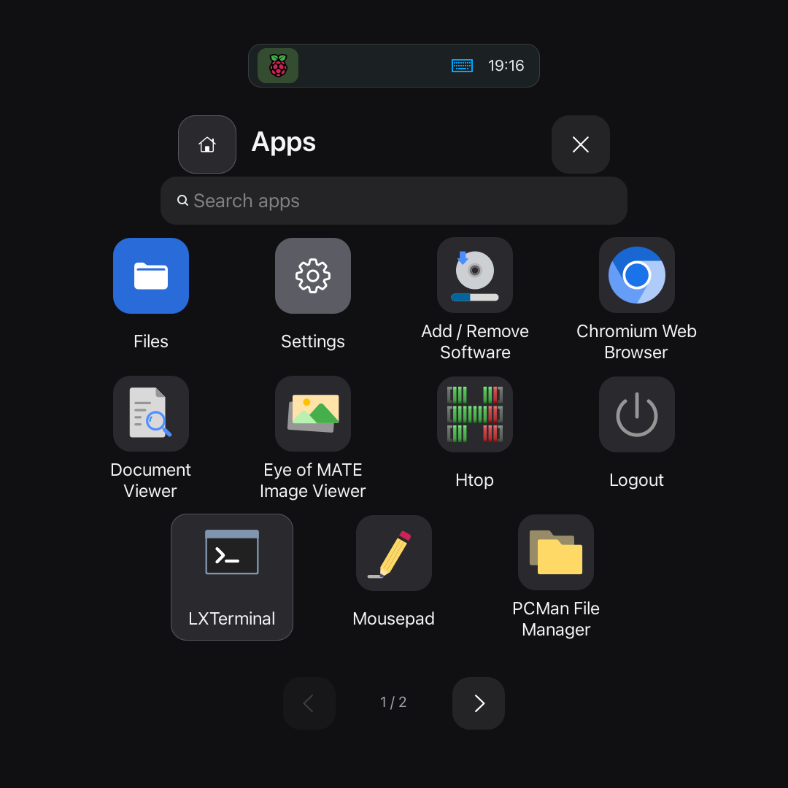

# AroundOS circular desktop

AroundOS uses labwc, GTK 3, wf-panel-pi and PCManFM on Raspberry Pi OS Desktop. The physical panel masks the corners of the square 1080 × 1080 framebuffer. Native apps size rows and toolbar controls to fit the visible circle.

## Install and restore

Confirm that the round display uses HDMI-A-1 at 1080 × 1080 and scale 1. Start a labwc desktop session and open a terminal in the AroundOS checkout. Run the installer as that desktop user:

```sh
python3 scripts/round-desktop.py install
```

The installer configures the panel, theme, compositor rules, launchers and autostart entries. It compiles the GTK module, installs the bundled Rubik font and sets the cursor theme. The checkout must stay at the installed location. Reopen applications that cache these settings.

To restore, close the AroundOS applications and run:

```sh
python3 scripts/round-desktop.py restore
```

The installer records its baseline under the path referenced by `~/.local/state/aroundos-round/original-backup`. Keep that backup. Reapplying from the baseline can replace subsequent manual configuration. Optional app installers also have their own backup and restore procedures.

## Apps and the home dock

The launcher reads installed desktop entries. Search for an app or swipe between pages. Open Utilities for the grouped system tools. Tap the Home button to minimize windows and show the desktop. The dock appears on the home screen. Running apps remain accessible through the top bar.



Files supports folder navigation, search, sorting, hidden files and launching the system default app for a file. **Open classic Files** opens PCManFM for file operations. Photos provides pinch-to-zoom, panning and fullscreen viewing. Use Escape or the two-finger hold to exit fullscreen.

## Text Editor

Open a text file from Files or launch Text Editor. Ctrl+O opens a file, Ctrl+S saves, Ctrl+Shift+S opens Save As and Ctrl+W closes the document. A dot beside the name marks unsaved changes. If the file changes on disk, use Save As to preserve both versions.

Run `python3 scripts/install-round-editor.py` in the checkout to register the app and file associations. The editor supports local UTF-8 files up to 4 MiB.

## Task Manager

Task Manager shows CPU and RAM use. Search by process name, PID or user. Sort by CPU, memory or name, or pause updates to inspect a row. Select a process for details. Ending or forcibly quitting a process requires confirmation and can discard unsaved work. The tool restricts those actions to eligible processes owned by the current user.

Register the app with `python3 scripts/install-round-tasks.py`.

## Circular screenshots

Tap **Print Screen** to save a circular PNG with transparent corners under the XDG Pictures directory in `Screenshots/`. Hold the key for more than four seconds to start a recording after a countdown. Press it again to stop and save, or use the capture indicator in the top bar. Recordings are silent WebM files in `~/Videos/Recordings/`. Wait for the saving indicator to clear before shutting down.

Capture requires the GTK and Cairo Python bindings, `grim`, FFmpeg, a readable keyboard input device and `wf-recorder` at `~/.local/bin/wf-recorder`. Run `python3 scripts/install-round-screenshot.py` in the desktop session to install the shortcut and controller autostart. The installer backs up the compositor configuration. To restore the old shortcut, stop the controller, remove its `aroundos-recording.desktop` autostart entry and use `python3 scripts/install-round-screenshot.py restore BACKUP_RC_XML` with that backup.

## Verification

Live checks require the corresponding desktop, display and application dependencies. Close applications under test before running them. Examples include:

```sh
python3 scripts/check-round-files.py
python3 scripts/check-round-shell.py
python3 scripts/check-round-photos.py
python3 scripts/check-round-touch.py
```

See the [Browser guide](browser.md) and [Videos guide](videos.md) for their installers and checks.
